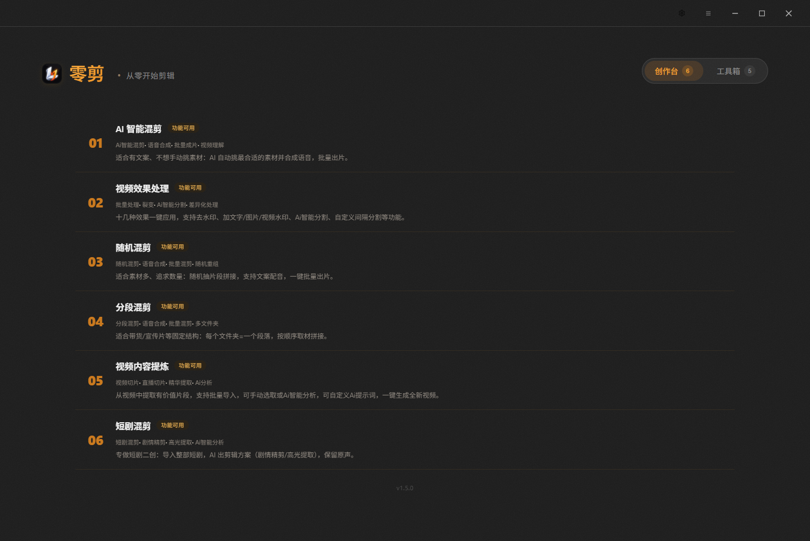
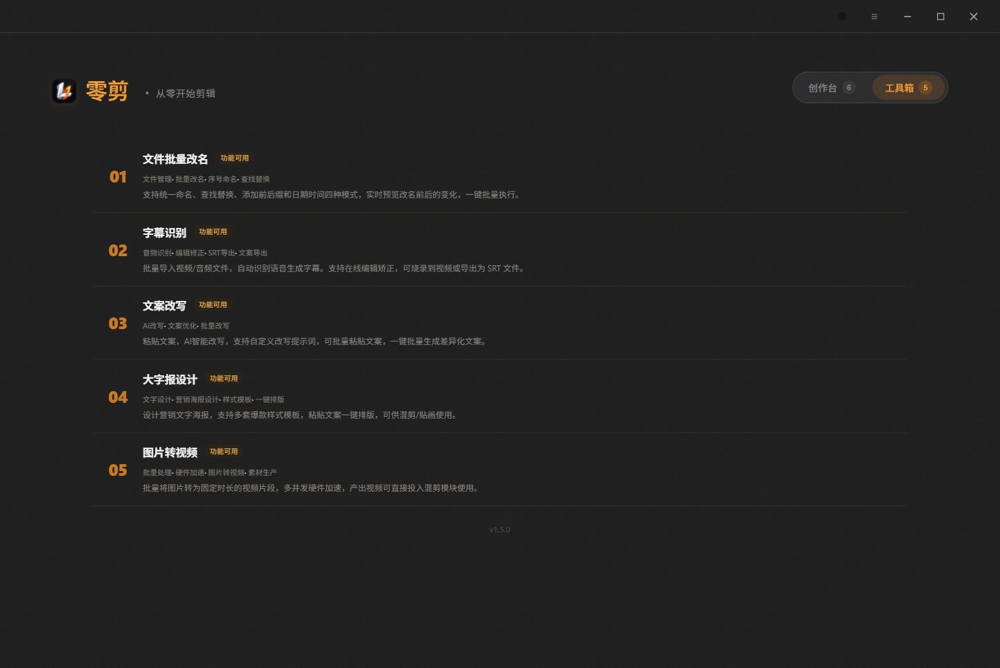

# 零剪 视频批剪

> Windows 桌面批量视频混剪与处理工作站：AI 混剪、短剧处理、批量去水印、火山语音合成与文案改写，追量起号一站式完成。免安装，解压即用。



---

## 核心能力

- **七大混剪模式**：AI 智能混剪、短剧混剪、随机混剪、分段混剪、画中画混剪等，自动抽帧、抽音频、多镜头重组。
- **短剧批量混剪**：针对短剧连载特性，自动提取高潮切片、多镜头重组、批量加钩子前置，效率提升 10 倍以上。
- **批量效果与水印**：批量消除原视频水印、添加画中画/动态贴纸/文字水印、片头片尾自动化拼接。
- **智能分割与变速**：AI 镜头语义分割、自定义间隔分割、动态曲线变速，深度防搬运。
- **火山 AI 极速配音与文案改写**：软件直连字节火山方舟大模型（Doubao）与火山语音合成（TTS），支持输入自备 Key，秒级重写文案并合成真人级自然原声。
- **效率工具箱**：图片批量转视频、音频一键提取、格式批量转换、素材自动重命名等。
- **卡密授权与守护**：C# 启动器卡密门禁 + 在线心跳保活 + 设备绑定，支持云端自动检测版本更新。

---

## ⬇ 软件下载与发布渠道

- **国内高速直链（魔搭主渠道，推荐）**：
  **[👉 零剪_v1.6.1_客户试用版.zip (魔搭社区高速直链)](https://www.modelscope.cn/models/lingxiaoyiyu/lingjian-releases/resolve/master/%E9%9B%B6%E5%89%AA_v1.6.1_%E5%AE%A2%E6%88%B7%E8%AF%95%E7%94%A8%E7%89%88.zip)**
  （374.7 MB ｜ Windows 10/11 64 位 ｜ 免安装便携版 ｜ 内置 FFmpeg 与离线模型）
- **GitHub Release（次渠道 / 镜像）**：
  <https://github.com/lingxiaoyiyu/lingjian-video/releases>
- **校验码 (SHA256)**：
  `907F40467EFBD7BD0243AE362225BAC160C0B64B6958D3A2A0D1C5B59EDEBBFE`

---

## 🎁 免费公开试用（每台电脑限用 8 小时）

```text
0001-0000-1002-A11E
```

下载解压后，双击运行 `零剪启动器.exe`，将上述卡密复制填入，点击「激活并进入」即可立享 8 小时全功能体验。
每台电脑享有独立的一次免费体验机会。试用结束后如需继续使用，请联系客服购买正式卡密。

---

## 界面展示

**创作台 —— 7 种混剪创作模式矩阵**


**工具箱 —— 4 种辅助处理与 AI 工具合集**



---

## 快速上手（客户端）

1. **解压**：下载 `零剪_v1.6.1_客户试用版.zip`，解压到任意文件夹（不含空格或中文特殊字符为佳）。
2. **启动**：双击 `零剪启动器.exe`。
   *（若出现 Windows SmartScreen 拦截提示，点击「更多信息」→「仍要运行」即可）*
3. **激活**：填入正式卡密或上方的免费试用卡，点击「激活并进入」，启动器自动校验并拉起主程序，无需配置任何环境。
4. **AI 配置（可选）**：如需使用文案重写或语音配音，点击软件右上角齿轮图标，填入自己的火山方舟 Key 即可。

---

## 购买卡密与客服支持

| 档位 | 价格 | 说明 |
| :--- | :--- | :--- |
| **月卡** | ¥88 | 短期起号 / 测款首选 |
| **季卡** | ¥168 | 折合 ≈ 56 元/月，高性价比 |
| **年卡** | ¥288 | 折合 ≈ 24 元/月，工作室推荐 |
| **永久卡** | ¥388 | 终身授权，永久免费更新 |

**客服联系方式**：
- **QQ**：`574719738`
- **微信**：`mowu0510`
- *(添加请备注「零剪」，付款后自动发卡)*

> - 一卡一机，首次激活自动绑定设备机器码。
> - 换电脑使用联系客服后台一键解绑，新机登录即可重新绑定。

---

## 研发与文档体系

本项目包含 **Tauri v2 + Vue 3 前端桌面程序（原地二进制重构）** + **C# 安全启动器门禁** + **Node.js 授权与更新服务器**。文档导航如下：

| 事项 | 文档入口 |
| :--- | :--- |
| **接手开发的最高准则** | [`AGENTS.md`](AGENTS.md) |
| 系统架构、模块地图、踩坑记录 | [`DEVELOPER_GUIDE.md`](DEVELOPER_GUIDE.md) |
| 发版标准操作指南 (SOP) | [`RELEASE_GUIDE.md`](RELEASE_GUIDE.md) |
| 版本变更台账 | [`CHANGELOG.md`](CHANGELOG.md) |
| 产品版本唯一真源 | [`version.json`](version.json) |
| 获客与对客落地页（魔搭） | [`魔搭落地页.md`](魔搭落地页.md) |
| 在线心跳授权与加固方案 | [`docs/09-在线心跳授权.md`](docs/09-在线心跳授权.md) |
| 发卡与运维操作手册 | [`docs/10-卡密部署与发卡手册.md`](docs/10-卡密部署与发卡手册.md) |

---

## 本地开发者构建命令

```powershell
# 1. 换皮主构建（品牌、配色、文案、bundle 常量、版本函数）
$env:BRAND_CONFIG='D:\零剪-视频剪辑\src\brand\brand_lingjian.json'
python src\build_v3.py

# 2. 图标应用（PE 6 尺寸槽位 + Tauri 窗口内嵌 RGBA 数组）
python src\icon_apply.py --apply
python src\fix_window_icon.py

# 3. 版本资源修正（PE VS_FIXEDFILEINFO）
python src\fix_exe_version.py

# 4. 编译在线版启动器（注入版本号、域名、验签密钥、心跳参数）
python launcher\build_online.py --server https://lingjian.xcbot.cyou

# 5. 组包装配与客户端打包
$env:BRAND_NAME='零剪'; $env:CORE_NAME='lingjiancore.exe'
python launcher\assemble.py
python tools\package_client.py
```

---

## 合规与免责声明

本软件仅供个人自媒体合规创作、音视频技术研究及学习交流使用。使用者应严格遵守中华人民共和国各项法律法规及各大平台的内容发布规范，不得用于任何违法违规、侵权侵犯他人知识产权的内容生产。因不当使用造成的任何法律后果由使用者自行承担。
